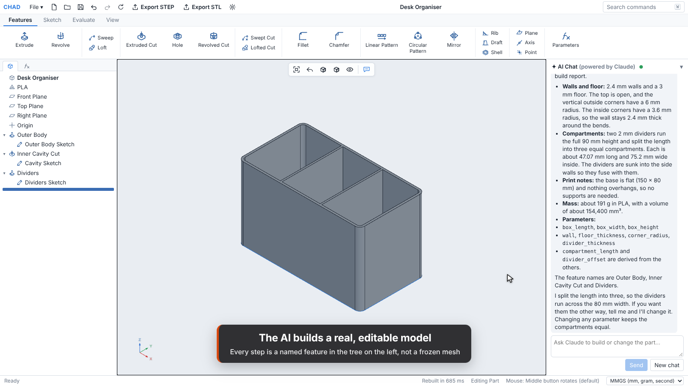
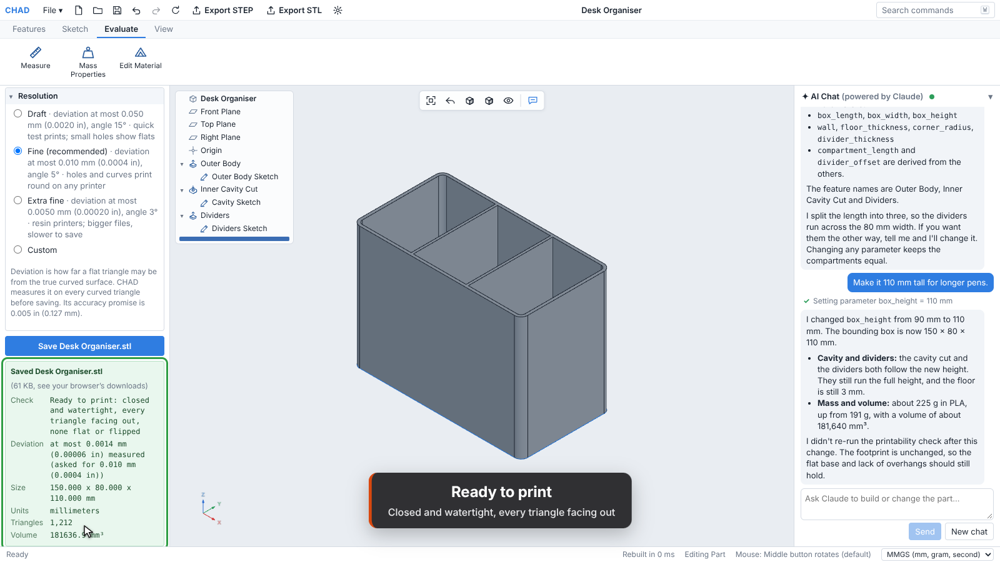
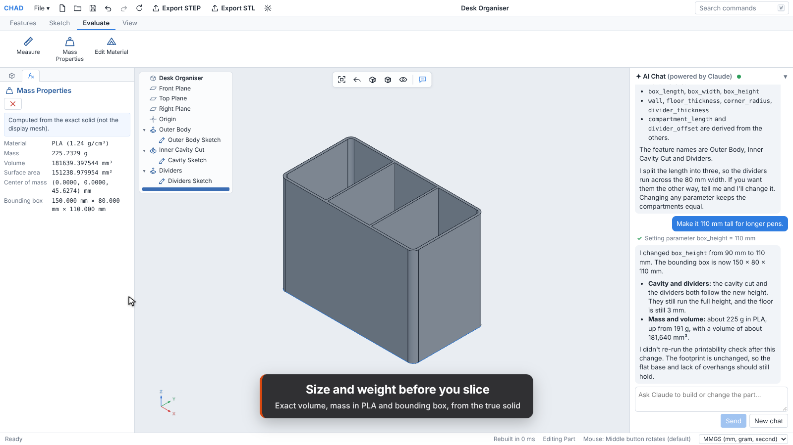
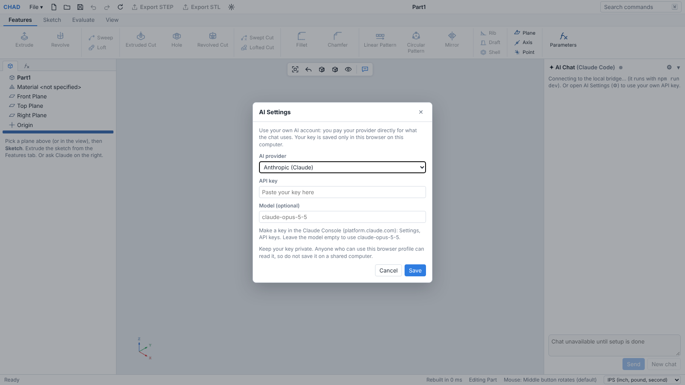

# CHAD

**Precision parametric CAD for 3D printing, with an AI chat that builds real, editable models.**

CHAD runs in the browser. You describe a part ("a desk organiser, 150 x 80 x 90 mm, three compartments, 2.4 mm walls") or model it by hand, and you get an exact solid with a full feature tree: every sketch, extrude, fillet and hole is a named step you can still edit. When it looks right, CHAD checks that the part is printable and exports a watertight STL or a clean STEP file.

Under the hood it uses a real CAD kernel (Open CASCADE Technology, compiled to WebAssembly), not a mesh generator, so sizes, volumes and exported files are exact to well within 0.005 in (0.127 mm).



## Features

- **AI chat that models, not just talks.** The AI works through the same commands as the toolbar: it adds named parameters, sketches and features, looks at shaded renders of its own work, checks the result, and reports exact sizes and mass. "Make it 110 mm tall" changes a parameter and everything downstream follows. A whole request is one undo step.
- **Bring your own AI key.** Anthropic (Claude), OpenAI or Google Gemini. The key stays in your browser and goes only to the provider you chose, through the site's own small proxy. Running locally, the chat can also use your Claude Code sign-in instead of a key.
- **Parametric feature modelling.** Sketch, extrude (all the usual end conditions, draft, thin walls), revolve, sweep, loft, fillet, chamfer, holes from real screw tables (counterbore, countersink, tapped), linear and circular patterns, mirror, shell, rib, draft, reference planes, axes and points, named parameters and expressions, rollback bar, suppress, rename.
- **Constraint-based sketcher.** Lines, arcs, circles, rectangles, slots and polygons with automatic relations, dimensions and exact typed entry; smooth splines from the AI chat. Under-, fully- and over-defined sketches are shown in different colours.
- **Organic shapes.** Smooth lofted bodies, tubes and splines for figurines and characters, with a library of tested reference models the AI can start from.
- **Ready-to-print check.** One closed solid, a watertight STL with every triangle facing out, no floating or barely touching pieces.
- **Exact exports.** Binary STL in millimetres with the measured deviation from the true surface; STEP AP214/AP242 that reads back as the same solid.
- **Size and weight before slicing.** Exact bounding box, volume, surface area, centre of mass and mass for PLA, PETG, ABS, nylon and more.
- **Safe by default.** Autosave with three restore points, crash recovery of the geometry worker, and undo/redo for every step.

| Ready to print | Size and weight |
|---|---|
|  |  |

## Run it locally

You need [Node.js](https://nodejs.org) 22 or newer (CI uses Node 24).

```
git clone https://github.com/zac37broncos-jpg/chat-cad-v1.git
cd chat-cad-v1
npm ci
npm run dev
```

Open http://localhost:5180 in Chrome, Edge or another Chromium-based browser. To use the AI chat, open the gear (⚙) in the chat panel, pick a provider, paste your own API key and press Save.

Other commands:

```
npm test            # unit, precision, AI tool, proxy, licence and privacy tests (Vitest)
npm run typecheck   # TypeScript, app and Node code
npm run build       # the static website, in dist/
npm run preview     # serve dist/ with the same headers as the published site
npm run smoke       # browser tests in real Chromium (first run: npx playwright install chromium)
npm run bench       # kernel benchmarks (timings are reported, not asserted)
```

On Windows you can also double-click `Start CHAD (Windows).bat` in a cloned copy. It updates the copy with Git, runs `npm install` and starts the app; if Claude Code is missing it also installs it (only needed for the optional local Claude Code chat mode).

## Deploy your own copy

CHAD is a static site plus one serverless function, `/api/proxy`, that forwards each user's own key to their AI provider. Settings for both hosts are already in the repository:

- **Vercel**: import the repository, keep the defaults, deploy (`vercel.json` sets the build and headers, `api/proxy.js` is the function).
- **Cloudflare Pages**: build command `npm run build`, output folder `dist`, environment variable `NODE_VERSION=24` (`public/_headers` sets the headers, `functions/api/proxy.js` is the function).

No API keys or secrets are configured on the server: each user brings their own. Step-by-step instructions: [docs/BYOK_AI.md](docs/BYOK_AI.md#deploy-the-proxy). What the host must send and why: [docs/DEPLOY.md](docs/DEPLOY.md).

## Your API key and security



- The key is saved in your browser's localStorage and sent only to this site's `/api/proxy` in a request header, which passes it on to the provider you picked (Anthropic, OpenAI or Google) over HTTPS. The proxy contacts no other address, follows no redirects, and never logs or stores keys.
- Anything in localStorage can be read by scripts running on the page, so CHAD loads no third-party scripts at all (no analytics, ads or widgets). Keep it that way if you fork it.
- Don't save a key on a shared computer, and set a spending limit with your provider. AI Settings has a button to remove the saved key.
- There are no keys, tokens or secrets in this repository; `tests/privacy.test.ts` and `tests/byok.test.ts` scan for them on every run.

Details: [docs/BYOK_AI.md, Security](docs/BYOK_AI.md#security).

## How it is built

- **TypeScript + React** for the app, **three.js** for the 3D view.
- **Open CASCADE Technology** (via `replicad-opencascadejs`, WebAssembly) in a Web Worker for all geometry: exact B-rep solids, booleans, fillets, lofts, mass properties, STL meshing and STEP read/write.
- **planegcs** (FreeCAD's constraint solver, WebAssembly) for sketches, with CHAD's own residual equations checking every solve.
- **Feature history with persistent naming:** fillets and holes keep pointing at the right faces when earlier dimensions change ([docs/TOPOLOGICAL_NAMING.md](docs/TOPOLOGICAL_NAMING.md)).
- **AI tools as data:** 35 CAD tools described in JSON Schema, run by one executor that both the bring-your-own-key chat and the local Claude Code bridge use, so every AI step goes through the same commands as the toolbar.

More: [docs/ARCHITECTURE.md](docs/ARCHITECTURE.md).

## Testing

CI runs on every push and pull request: typecheck, the full Vitest suite, the production build, and browser smoke tests in real Chromium that drive the app with the mouse and keyboard, serve the production build with its headers, and build parts through the real kernel. Geometry tests compare volumes, sizes and hole positions against hand calculations.

An independent check exported 21 test parts, 8 files each (STL at three resolutions, ASCII and inch STL, and three STEP variants, 168 files in all), and judged them with outside tools that share no code with the app (MeshLab, Manifold, trimesh, ADMesh, PrusaSlicer and a separate OpenCascade build). 1,585 of 1,586 checks passed; every Fine STL was within 0.01 mm of the exact model (except the joints of one deliberately old-seam test part, where the model's own joint accuracy is 0.019 mm), and every STEP file read back as one valid solid. The single check that did not pass is kept on the list rather than loosened, and the check also found and fixed a surface-area error in the Mass Properties panel on organic parts: [docs/PRINT_VERIFICATION.md](docs/PRINT_VERIFICATION.md).

## Documentation

- [Controls](docs/CONTROLS.md): mouse, keyboard, sketch keys and the feature tree
- [How the AI chat works](docs/AI_CHAT.md) and [bring your own key](docs/BYOK_AI.md)
- [Organic models](docs/ORGANIC_MODELING.md): splines, smooth lofts, reference models, checked booleans
- [Export and 3D printing](docs/EXPORT_AND_PRINT.md): units, slicer settings, STEP
- [What CHAD shows and hides](docs/CHAD_SCOPE.md)
- [Architecture](docs/ARCHITECTURE.md), [persistent naming](docs/TOPOLOGICAL_NAMING.md), [2D drawings (hidden in CHAD)](docs/DRAWINGS.md)
- [Deploying](docs/DEPLOY.md) and [licences](docs/LICENSES.md)

## Limitations

CHAD is a working prototype, and it is honest about what has not been proven yet:

- **No physical print has been measured yet.** The files pass every software check above, but a real printer and calipers are the final proof. The test procedure is in [docs/PRINT_VERIFICATION.md](docs/PRINT_VERIFICATION.md).
- **BYOK has not been run end to end with real paid keys.** Every request and response format is unit-tested against the providers' documented shapes, and the proxy reached Anthropic and Google with a fake key; try a simple part first on your provider.
- **OpenAI uses the Chat Completions API**, where tool calling works on GPT-6 Sol and Luna with reasoning off; expect weaker results on complex parts than with Claude. The BYOK chat cannot search the web (the local Claude Code mode can).
- **Tested in desktop Chromium browsers (Chrome, Edge) only.** The first visit downloads a ~22 MB WebAssembly kernel (cached after that). Phones and tablets are not supported.
- **No assemblies yet**, and 2D engineering drawings exist in the code but are hidden in this edition.

## How this was made

CHAD was built with AI assistance. The project owner defined the product, set the requirements and the quality bar, tested the app and made every product decision; the code, tests and documentation were written by Claude (Anthropic's AI model) working through Claude Code, under that direction. Changes are merged only when the automated checks above pass.

## Licence

CHAD's own code is released under the [MIT licence](LICENSE).

Its 3D engine is **Open CASCADE Technology (OCCT)**, Copyright © Open CASCADE SAS, used under the GNU LGPL 2.1 with the Open CASCADE Exception 1.0 (source: https://github.com/Open-Cascade-SAS/OCCT). The sketch solver **planegcs** is under the LGPL 2.0 or later. These and every other open-source part keep their own licences, listed in full in [public/THIRD_PARTY_NOTICES.txt](public/THIRD_PARTY_NOTICES.txt) and in the app under Options, About CHAD and licences. What this means for forks: [docs/LICENSES.md](docs/LICENSES.md).

Anthropic, Claude, OpenAI, GPT and Gemini are trademarks of their respective owners. They are named only to say which AI services CHAD can connect to; CHAD is not made by, affiliated with or endorsed by any of them.
